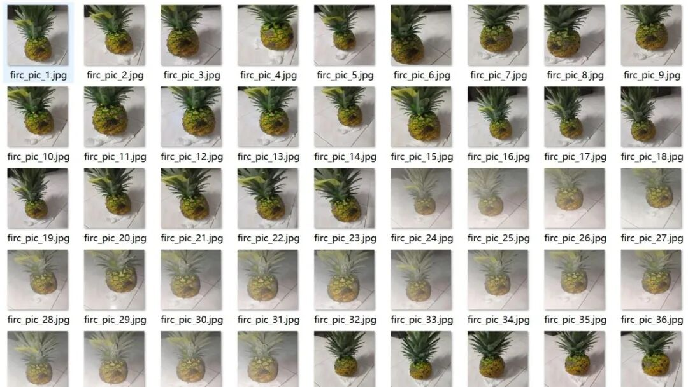
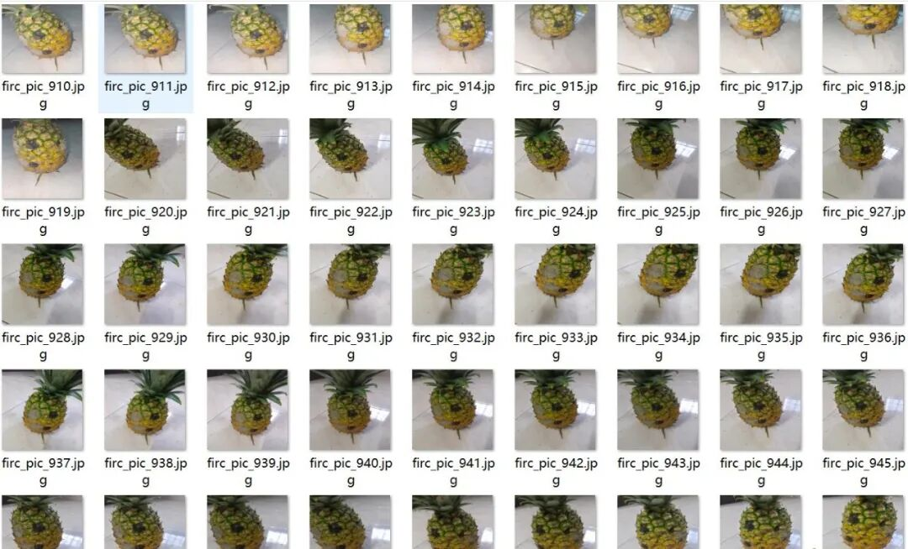
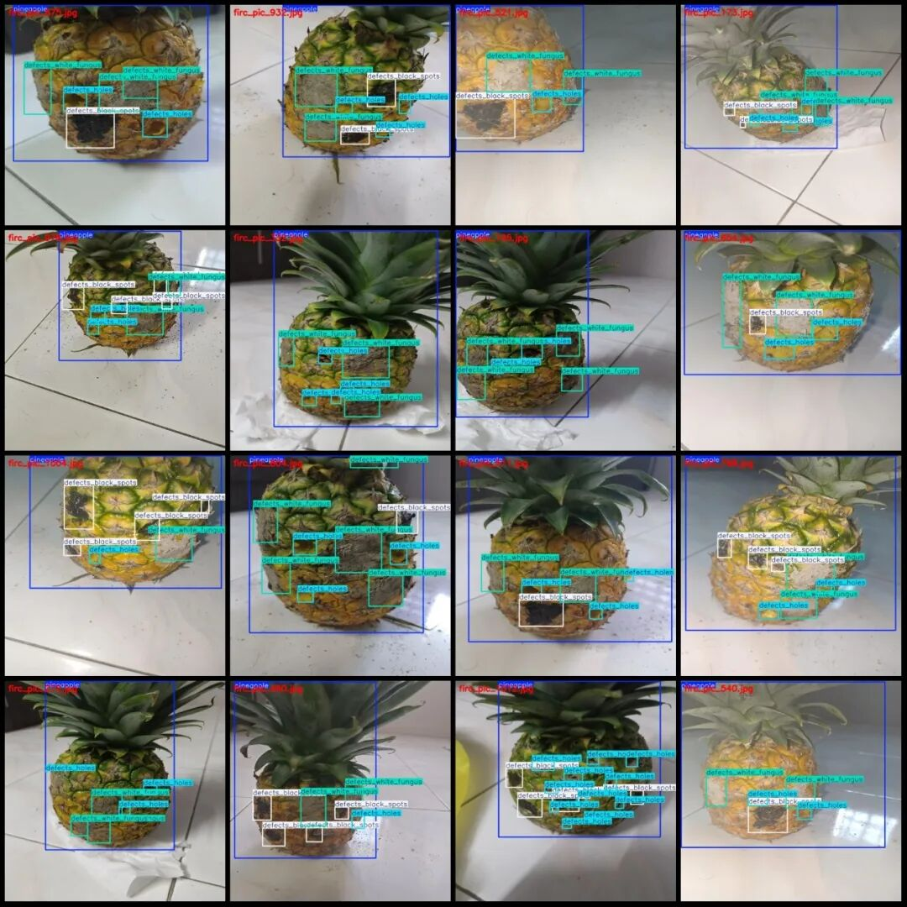
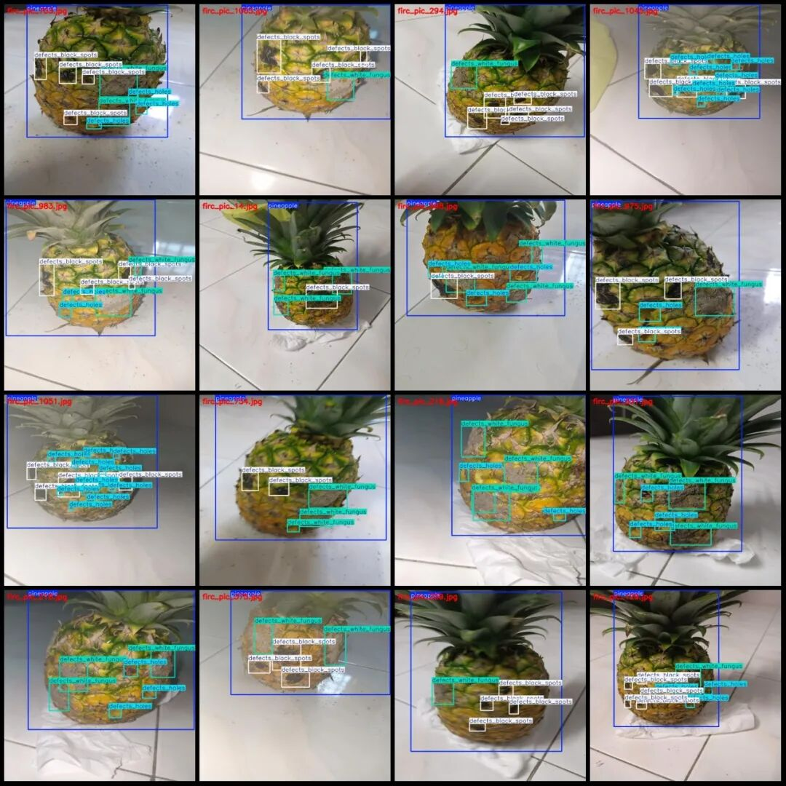
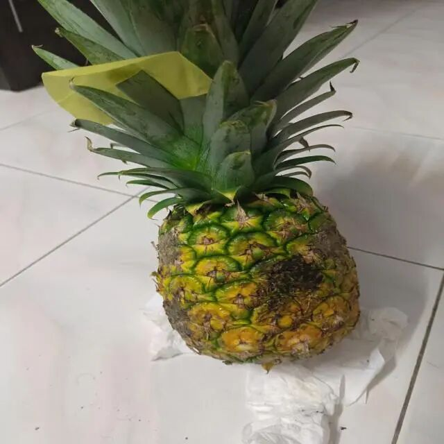
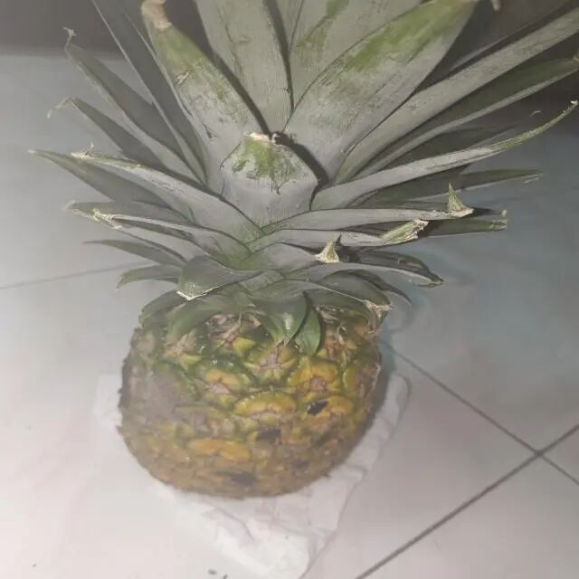
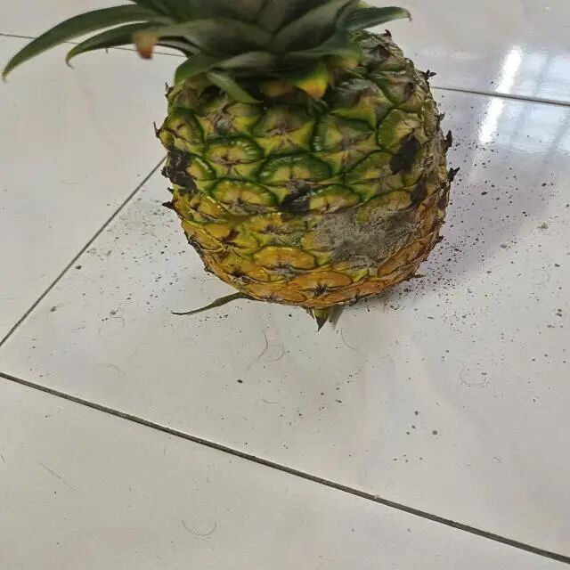

# Dataset for Detecting Macroscopic Defects in Pineapples: VOC+YOLO format with 1090 images across 4 categories

Dataset format: Pascal VOC format + YOLO format (txt file without split path, only containing jpg images and corresponding VOC format xml files and yolo format txt files)

Number of images (number of jpg files): 1090

Number of annotations (number of xml files): 1090

Number of annotations (number of txt files): 1090

Labeling category count: 4

Label category names (Note that the order of categories in the YOLO format does not correspond to this, but is based on the labels folder's classes.txt): ["defects_black_spots", "defects_holes", "defects_white_fungus", "pineapple"]

Number of boxes and the number of images occupied by each category:

defects_black_spots = 2336, frame_count = 2336, image_occupation_count = 937

defects_holes = 2612, frame_count = 2612, image_count = 831

defects_white_fungus (white mold defects) Frame count = 2263, Image count = 996

Pineapple (pineapple) Frames = 1097, Pictures = 1089

Total frame count: 8308

Image resolution: 640x640

Using labelImg:

Annotation rules: Draw a rectangle around the category.

Important Notice: The dataset does not have separate training, validation, and test sets; you need to partition them yourself.

Special : This dataset does not guarantee the accuracy of the trained models or weight files.

Image Preview:

Annotation example:

Single image:

## Payment

Here is a pay link on Stripe ( https://buy.stripe.com/3cs8yP7sY87d0vu9AB ). Please contact me lonlonago@foxmail.com after funding $89, and I will send you a complete data files , thank you!

